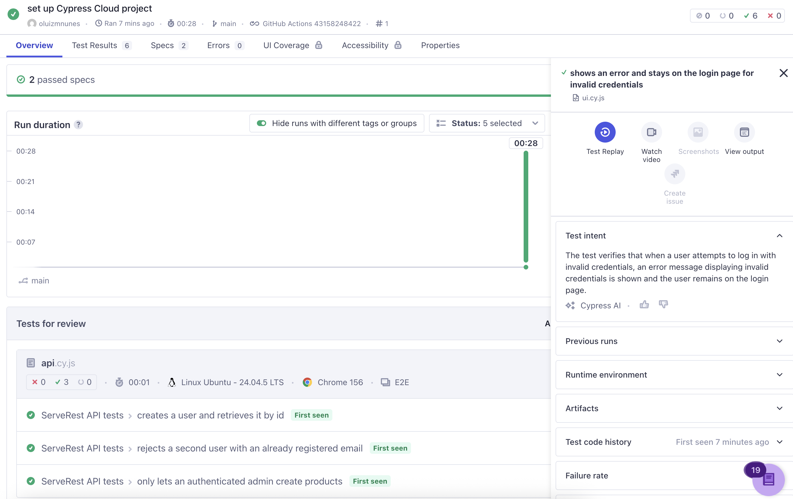

# ServeRest – Cypress tests

E2E (frontend) and API tests for ServeRest, written in Cypress + JavaScript.

## Application under test

- Frontend: https://front.serverest.dev
- API (Swagger): https://serverest.dev

## Prerequisites

Before running the tests, ensure you have the following installed:

- Node.js (version 14 or higher)
- npm (Node Package Manager)

## Run

```bash
npm init -y
npm install --save-dev cypress
npx cypress open      # interactive
npx cypress run       # headless
```

## Cypress Cloud reports

After the pipeline runs on GitHub Actions, test reports are available on [Cypress Cloud](https://cloud.cypress.io/projects/fvtch4/). Open the **Runs** tab for detailed results, including screenshots and videos of the test runs.



## Structure

```
cypress.config.js               baseUrl (frontend) and apiUrl (API)
cypress/support/helpers.js      unique test data, API request wrapper, user/login setup
cypress/e2e/api/                API scenarios
cypress/e2e/ui/                 E2E scenarios
```

## Scenarios

| # | Layer | Scenario | Why it matters |
|---|-------|----------|----------------|
| 1 | API | Register a user and fetch it by id | Happy path, confirms persistence |
| 2 | API | Duplicate email is rejected (400) | Business rule, negative path |
| 3 | API | Product creation requires an admin token (401 without, 201 with) | Authorization, plus cleanup via DELETE |
| 4 | UI | Register a new admin user and land on the admin home | Main registration flow |
| 5 | UI | Invalid login shows an error and stays on /login | Negative path |
| 6 | UI | Admin creates a product and sees it in the list | Core business flow |

## Design choices

- Each test creates its own data (unique emails and product names), so tests are independent and can run in any order.
- Preconditions go through the API (`createUser`), so UI tests only exercise the flow they are about.
- `failOnStatusCode: false` on API calls lets negative tests assert 4xx responses.
- Selectors use `data-testid` attributes, which are more stable than CSS classes or text.